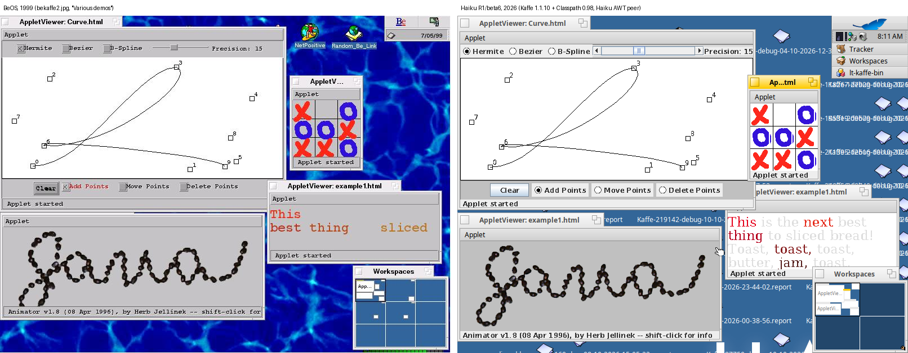
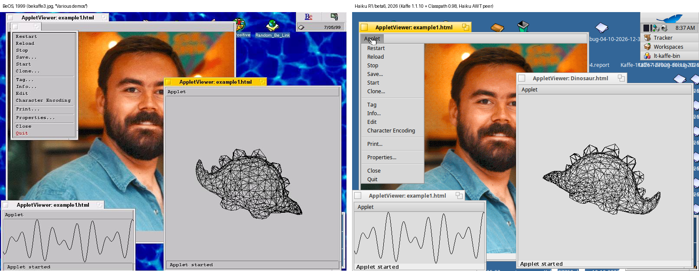
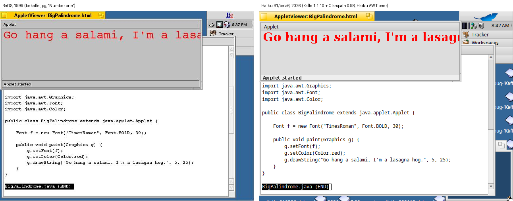

# BeKaffe: AWT for Kaffe on Haiku

Project page: <https://duncanmcqueen.github.io/bekaffe/>

This repository has an AWT toolkit peer for the Kaffe Java VM on Haiku. With the peer,
AWT and Swing programs and JDK 1.0/1.1 applets run in native Haiku windows.

- VM: Kaffe 1.1.10-pre, interpreter engine, on Haiku R1/beta6 x86_64. Upstream
  ([kaffe/kaffe](https://github.com/kaffe/kaffe)) is archived. BeKaffe uses the fork
  [duncanmcqueen/kaffe](https://github.com/duncanmcqueen/kaffe) (`haiku` branch), which has
  the Haiku port and fixes for memory-safety vulnerabilities.
- Alternative VM (work in progress): [JamVM](https://github.com/ingelabs/jamvm), ported to
  Haiku x86_64. It runs the same Classpath build and peer, and is 17 to 36 times faster than
  Kaffe. See [JamVM](#jamvm-work-in-progress).
- Class library: GNU Classpath 0.98.
- The peer is `gnu.java.awt.peer.haiku`. Select it with
  `-Dawt.toolkit=gnu.java.awt.peer.haiku.HaikuToolkit`. For printing with the Haiku print
  server, also give `-Djava.awt.printerjob=gnu.java.awt.peer.haiku.HaikuPrinterJob`
  (the launchers in `src/` do this).

The name comes from the [BeKaffe project](http://bekaffe.sourceforge.net/) (1999), which
ported Kaffe 1.0 with its own AWT to BeOS. This peer is new code for the Classpath peer model.
It does not use the BeKaffe code.

## Screenshots

The screenshots from bekaffe.sourceforge.net (1999, BeOS, left) and the same applets on
Haiku in 2026 (right). The applet viewer is Kaffe 1.0's AppletViewer, the same viewer that
the 1999 screenshots show.

## What works

- Frame, Dialog and Window are native `BWindow`s. Mouse, keyboard, focus, resize and close
  events go to AWT.
- MenuBar, Menu, MenuItem, CheckboxMenuItem and menu shortcuts use a native `BMenuBar`.
  PopupMenu and the Choice list use `BPopUpMenu`. FileDialog uses `BFilePanel`.
- Canvas, Panel, Label, Button, Checkbox (also with CheckboxGroup), TextField, Scrollbar,
  List, ScrollPane and Choice. Swing components draw the widgets.
- Swing (Metal look and feel).
- The AWT 1.0 event model (`action()`, `handleEvent()`, `mouseUp()` and others). Old applets
  need it.
- Drawing goes into a back buffer that is copied to a `BBitmap`. The common operations
  are native code (`HaikuRaster`): rectangles, lines, shapes with or without
  anti-aliasing, gradients, images through any transform, and `copyArea`. They are 10 to
  thousands of times faster than the generic Java code on Kaffe's interpreter (see
  `src/test/DrawBench.java`). Other cases use GNU Classpath's Java code. XOR mode is
  supported.
- Text uses Haiku's fonts (`HaikuFontPeer`): Haiku measures it (BFont advances) and the
  app_server draws it, so it is hinted, anti-aliased and spaced like the rest of Haiku, and
  Haiku's font fallback covers scripts such as Chinese and Japanese. Dialog and SansSerif
  map to the plain font, Monospaced to the fixed font, Serif to a serif family. Rotated
  text and text with gradient paints use the glyph outlines.
- The system clipboard: text, pictures (as an archived bitmap, like ShowImage, and as PNG),
  files and other MIME data go to and from other Haiku applications (`be_clipboard`). The
  Command-X/C/V/A shortcuts work in text components.
- Drag and drop through Haiku's drag system: between Java components, from Tracker and
  other applications into Java (files, text, pictures, MIME data), and from Java into
  other applications (for example text into StyledEdit).
- Printing with Haiku's print server: `Toolkit.getPrintJob()` and
  `java.awt.print.PrinterJob`, with Haiku's page setup and print dialogs, or the default
  settings when there is no dialog.
- Input methods: composed text goes inline to components with `InputMethodRequests`;
  other components get the confirmed text, and the composed text shows in a small window
  below the caret.
- Modal dialogs block input to the other windows of the application, and always-on-top
  windows float above all windows.
- Mouse cursors: all predefined `Cursor` types map to Haiku system cursors, and
  `Toolkit.createCustomCursor()` makes a native `BCursor`. The cursor follows the
  component under the mouse, as in other toolkits.
- Sound: `gnu.javax.sound.sampled.haiku` is a `javax.sound.sampled` mixer with `Clip` and
  `SourceDataLine` lines that play through the Haiku media server (`BSoundPlayer`). It
  plays 8 and 16 bit PCM, mu-law and a-law, mono and stereo, at any rate, with gap-free
  loops and a master gain control. Applet sound (`AudioClip`, `.au` files) works.
- FileDialog filters: a `FilenameFilter` decides which files the Haiku file panel shows.
  A file name such as `*.txt;*.java` also works as a filter.
- Minimize and zoom: `Frame.setExtendedState()` with `ICONIFIED`, `MAXIMIZED_BOTH` and
  `NORMAL`. When the user minimizes or zooms the window, AWT gets the window state events.
- GNU Classpath build integration: a patch adds the peer to Classpath 0.98, with
  `configure --enable-haiku-peer` (on by default on Haiku).

Not done yet: with a clip that is not a rectangle, images are clipped to the bounding
rectangle of the clip, and rotated images are not drawn (GNU Classpath's generic image
code). Drag and drop to other applications cannot tell the
Java drag source whether the drop was accepted (it reports a copy).

## Contents

| Path | Contents |
|------|----------|
| `src/gnu/java/awt/peer/haiku/` | The peer (Java). |
| `src/gnu/javax/sound/sampled/haiku/` | The sound mixer (Java). |
| `src/native/haiku-peer/` | The native library `libhaikupeer.so` (C++, Haiku API). |
| `src/resource/gnu/java/awt/font/fonts.properties` | Maps the Java logical fonts to the DejaVu fonts on Haiku. |
| `src/applet/bekaffe/applet/` | Kaffe 1.0's AppletViewer, changed to work with Classpath (see below). |
| `src/demos/` | Demo applets for the screenshots. |
| `src/test/` | Test programs. `AwtWidgets` shows all AWT widgets. `AwtExtras` tests the clipboard, cursors, frame state, FileDialog filters and sound. `AwtMore` tests modal and always-on-top windows, drag and drop, printing, input methods and pictures on the clipboard. `FontTest` shows fonts, styles, CJK, rotated and gradient text, with the measured widths. `CliTest` checks a Kaffe + Classpath build without a GUI. `FixTests` checks the Kaffe memory-safety fixes (compile it with `-source 1.5 -target 1.5 -encoding UTF-8`). `DrawBench` times drawing operations; `ClipTest` draws through a clip that is not a rectangle. |
| `src/build.sh`, `src/run.sh` | Build and run scripts for the Haiku side (development overlay). |
| `src/build-classpath.sh`, `src/run-classpath.sh` | Build GNU Classpath with the peer on Haiku, and run with that build. |
| `src/build-jamvm.sh`, `src/run-jamvm.sh` | Build JamVM on Haiku against that Classpath build, and run with JamVM. |
| `sync.sh`, `runtest.sh`, `runav.sh` | Host scripts for a Haiku VM under QEMU (they use `../vm/vmssh.sh`, `mon.sh` and `shot.sh`). |
| `patches/kaffe/` | The Kaffe port to Haiku x86_64, the memory-safety fixes and a `Thread` constructor fix, as patches. The same changes are on the `haiku` branch of [duncanmcqueen/kaffe](https://github.com/duncanmcqueen/kaffe). |
| `patches/jamvm/` | The JamVM port to Haiku x86_64, a fix that stops user class loaders from defining `java.*` classes, and a fix for a crash in stack traces of deep threads. Offered upstream as [ingelabs/jamvm#25](https://github.com/ingelabs/jamvm/pull/25), [#24](https://github.com/ingelabs/jamvm/pull/24) and [#26](https://github.com/ingelabs/jamvm/pull/26). |
| `patches/classpath-ingelabs/` | Adds the peer to [ingelabs/classpath](https://github.com/ingelabs/classpath), with fixes that Kaffe on Haiku needs. |
| `patches/classpath-0.98/` | The same for the GNU Classpath 0.98 release. |
| `tools/` | Screenshot helpers. `mousemode.cpp` sets the Haiku focus mode. `tonetest.cpp` checks sound output without Java. `msgtest.cpp` sends clicks and input method events straight to a Java window, and puts pictures on the clipboard. |
| `screenshots/` | The 2026 screenshots, the comparisons, and the 1999 originals (`1999/`). |
| `docs/development-notes.md` | Detailed working notes: design, Kaffe and Classpath bugs, and how the screenshots were made. |

## Build

You need Haiku x86_64, the OpenJDK 8 package (only for `javac`), and GCC.

1. GNU Classpath: clone [ingelabs/classpath](https://github.com/ingelabs/classpath) (a
   maintained continuation of GNU Classpath 0.99; tested at commit 0406074a5), apply
   the patches in `patches/classpath-ingelabs/` with `git am`, then run
   `autoreconf -fi` on any machine with autoconf, automake, libtool and gettext (Haiku does
   not need libtool installed). Copy the tree to Haiku and build it with
   `src/build-classpath.sh`: set `CP_DIR` to the build directory and
   `CP_CONFIGURE="--enable-default-preferences-peer=file --disable-tools"`. The script
   configures with `--enable-jni --disable-gtk-peer --disable-gconf-peer --disable-plugin
   --disable-gjdoc --disable-examples` and fixes file times if the Haiku clock is behind
   the machine that ran autoreconf. The Haiku peer is built by default on Haiku and is the
   default AWT toolkit; `libhaikupeer.so` is in the native library directory with the other
   Classpath JNI libraries.
2. Kaffe: clone the `haiku` branch of [duncanmcqueen/kaffe](https://github.com/duncanmcqueen/kaffe),
   a fork of the archived [kaffe/kaffe](https://github.com/kaffe/kaffe) with the Haiku port
   and memory-safety fixes. (The same changes are in `patches/kaffe/`: apply 0001 to 0004
   to `kaffe/kaffe` with `git apply`.) Configure with the
   interpreter engine and `--with-classpath-classes=<Classpath>/share/classpath/glibj.zip`.
   Kaffe makes C headers from the Classpath classes (kaffeh) and compiles its
   `kaffe-vminterface.jar` against them, so build Kaffe after Classpath.
3. Run: `src/run-classpath.sh <Class>` (set `CP_INSTALL` and `KAFFE_DIR` if your
   directories differ). It puts Classpath's `glibj.zip` on Kaffe's boot class path and the
   native library directory on `KAFFELIBRARYPATH`. AWT, Swing and sound programs need no
   extra options.

The Classpath changes are offered upstream as draft pull requests:
[#57](https://github.com/ingelabs/classpath/pull/57) (drag and drop fixes),
[#58](https://github.com/ingelabs/classpath/pull/58) (AWT fixes),
[#59](https://github.com/ingelabs/classpath/pull/59) (build and run-time fixes),
[#60](https://github.com/ingelabs/classpath/pull/60) (Haiku host support) and
[#61](https://github.com/ingelabs/classpath/pull/61) (the Haiku toolkit and mixer).
Together they are the same change as `patches/classpath-ingelabs/`.

The older GNU Classpath 0.98 release also works: use
`patches/classpath-0.98/0001-haiku-peer-and-fixes.patch` with the 0.98 tarball. The
ingelabs version has about 200 more fixes (for example process spawning, `BigDecimal`,
`java.util.Objects` and `java.io.Console`); `src/test/CliTest.java` passes there and fails
three checks on 0.98.

For development there is a quicker loop that does not rebuild Classpath: copy `src/` to
the Haiku machine, set the paths at the top of `src/build.sh` and `src/run.sh` (they use
`/boot/home/Projects/bekaffe`), and run `./build.sh`. The script compiles the peer into a
`classes/` overlay that goes first on `BOOTCLASSPATH`, builds `lib/libhaikupeer.so`
(`-lbe -ltracker -lmedia -ltranslation`), and compiles the tests and demos. Then run `./run.sh AwtWidgets`,
`./run.sh AwtExtras`, or `./run.sh bekaffe.applet.AppletViewer demos/TicTacToe/example1.html`.

`docs/development-notes.md` has the full commands and the known problems.

## JamVM (work in progress)

[JamVM](https://github.com/ingelabs/jamvm) is a small Java VM for GNU Classpath. Its
fastest interpreter mode joins the machine code of the bytecodes in each block. JamVM's
README says that this is about as fast as a simple JIT. Kaffe is archived; ingelabs maintains JamVM, and also the Classpath version
that BeKaffe uses. JamVM uses the same Classpath build as Kaffe, and the peer does not
change: it uses only standard JNI.

To build it:

1. Build GNU Classpath as in step 1 above.
2. Clone [ingelabs/jamvm](https://github.com/ingelabs/jamvm) (tested at commit bba91d8),
   apply the patches in `patches/jamvm/` with `git am`, and run `./autogen.sh` and then
   `make distclean` on any machine with autoconf, automake and libtool. Copy the tree to
   Haiku as `jamvm/` in the work directory. Copy files, not links: `autogen.sh` can make
   symbolic links to the host's automake files (use `tar -h`).
3. Build with `src/build-jamvm.sh` (set `B` and `CP_INSTALL` if your directories differ).
   It installs to `jamvm-install/`.
4. Run: `src/run-jamvm.sh <Class>`. JamVM finds `glibj.zip` from its configure setting,
   and the JNI libraries through `LIBRARY_PATH`. The heap starts at 16 MB and can grow to
   256 MB. For a larger heap, set `JAMVM_OPTS`, for example `JAMVM_OPTS=-Xmx1g`. (On Haiku,
   JamVM reserves the whole maximum heap in RAM and swap at startup, so the default stays
   small.)

Results on Haiku R1/beta6 x86_64 (2026-10-16):

- AWT and Swing programs, the applet viewer and the demo applets, input events, and sound
  work. `FixTests` and `CliTest` pass. `DrawBench` draws the same pixels as on Kaffe.
- A thread and garbage collector stress test (16 threads) passed 10 runs of 10.
- Speed against Kaffe: a CPU benchmark is 17 times faster (362 ms against 6347 ms),
  the stress test 36 times (6.5 s against 235 s), and `DrawBench` 20 times (2.8 s against 57 s).
- Kaffe's regression suite: 129 of 149 tests pass. Kaffe passes 137. (`RefTest` sometimes
  fails on JamVM: it exits before the finalizer thread can print, and Java does not
  promise that finalizers run before exit.) Most of the
  differences are exception messages and stack trace formats that the expected output takes
  from Kaffe, and tests of Kaffe internals. JamVM passes `WaitTest`, `PropertiesTest`,
  `DateFormatTest` and `SecureRandomTest`, which fail on Kaffe.
- `SecurityMan` hangs on JamVM and also on OpenJDK 8. The test asks for a class that does
  not exist, from a security manager. With two class path entries, each lookup checks files,
  which calls the security manager again.
- `ProhibitedClass` failed: a user class loader could define `java.lang.Object`.
  `patches/jamvm/0002` fixes this. JamVM now throws the same `SecurityException` as
  OpenJDK ("Prohibited package name").

Security review (2026-10-17): an [OpenAnt](https://github.com/knostic/OpenAnt) scan of the
JamVM sources reported 10 problems, and each one was checked by hand on Haiku. JamVM does not
verify bytecode, so it cannot safely run untrusted classes; the review looked for problems
that normal Java code can cause.

- `getThreadInfo()` for a thread with a very deep stack crashed the VM, because the trace
  buffer was on the native stack of the calling thread. `patches/jamvm/0003` fixes this:
  stack traces of running threads now have a maximum of 4096 frames (the newest ones), and
  the buffer is allocated before the thread lock is taken.
- The class file parser does not check lengths, so a damaged class file can crash the VM
  instead of giving `ClassFormatError`. This is not fixed yet; see
  [ingelabs/jamvm#27](https://github.com/ingelabs/jamvm/issues/27).
- The other reports were not real problems: `System.arraycopy` already catches the overflow,
  and `sun.misc.Unsafe`, `System.load()` and JNI calls with `NULL` objects work as designed.

The patches are offered upstream: [#25](https://github.com/ingelabs/jamvm/pull/25) (Haiku
support), [#24](https://github.com/ingelabs/jamvm/pull/24) (the `java.*` check) and
[#26](https://github.com/ingelabs/jamvm/pull/26) (the stack trace fix).

Not done yet: bounds checks in the class file parser, and a check of
`ExceptionTestClassLoader2` and `ReflectInterfaces`.

## The Kaffe and Classpath patches

The Kaffe patches are working-tree snapshots, not clean upstream patches.

- `0001-haiku-x86_64-port.patch`: Haiku host detection (`config.guess`, `config.alias`), the
  `config/x86_64/haiku/` platform files, `SIGIO`, header fixes, and a fix in
  `config/x86_64/sysdepCallMethod.h`: native methods that return `boolean`, `byte`, `char`
  or `short` are called through correctly typed function pointers. Without this fix the
  upper bits of `%eax` are garbage, and `Class.isPrimitive()` returns true for every class.
  The patch also has local workarounds: the version string is set to "Interpreter", and the
  shared library suffix is set to `.so`.
- `0002-regenerated-configure.patch`: the `configure` script after the Haiku changes.
- `0003-memory-safety-fixes.patch`: fixes for buffer overflows and reads past the end of a
  buffer in the class file reader, the verifier, UTF-8 string conversion, multi-dimensional
  arrays and the JNI symbol lookup (see `docs/development-notes.md`).
- `0004-thread-constructor.patch`: Kaffe makes the `Thread` object of the main thread with
  Classpath's `Thread(VMThread, String, int, boolean)` constructor, as the Classpath
  maintainer suggested in [ingelabs/classpath#65](https://github.com/ingelabs/classpath/pull/65).
  Before, Kaffe set only some fields from C: `Thread.locals` was null (each `ThreadLocal`
  failed, and Kaffe stopped before `main()`) and `Thread.getId()` returned 0.
- `patches/classpath-ingelabs/` (two commits: the peer and fixes, then native drawing)
  is a clean patch series for GNU Classpath. `patches/classpath-0.98/` is the older state
  of the same work (without native drawing) for the 0.98 release.
  It adds the peer, the sound mixer and `native/jni/haiku-peer/`, the `--enable-haiku-peer`
  configure switch (it also makes HaikuToolkit the default toolkit and looks for socket
  functions in `libnetwork`), and `fonts-haiku.properties` (`OpenTypeFontPeer` now reads
  `fonts-<os.name>.properties` first). It also fixes `Frame.setState()`, which set the
  opposite state, makes `PrinterJob.getPrinterJob()` use the `java.awt.printerjob`
  property, implements `OpenTypeFontPeer.canDisplay()`, and fixes drag and drop
  (`DragSource` reused its first drag context for every drag, the drop events rejected
  all valid source actions, `DropTargetContext` returned no data flavors and no target
  actions). It also has fixes for building and running on Haiku: lazy `Thread.locals`
  (Kaffe; not needed with `patches/kaffe/0004`, and to be removed), the static field order in `ResolverCache`, `IFF_RUNNING`, a fallback when
  `gethostbyname_r` exists but is not declared, a `configure.ac` typo that made new autoconf
  versions miss `mmap`, and out-of-tree builds that put an empty sound mixer list in
  `glibj.zip`. With the regenerated `config.sub`, configure runs natively as
  `x86_64-unknown-haiku`.

## The applet viewer

`src/applet/bekaffe/applet/` is `kaffe.applet.AppletViewer` from Kaffe 1.0. Kaffe does not
load `kaffe.*` classes from the class path, so the package is now `bekaffe.applet`. Changes:
`-x` and `-y` window position options, the Java 1.4 `AppletContext` stream methods, the
applet gets its size before `init()`, a fix for the `documentBase` field, and an
`AudioPlayer` that plays applet sounds with `javax.sound.sampled`.

## Licenses

- The peer, the native library and `fonts.properties` are part of GNU Classpath style code:
  GPL version 2 or later, with the Classpath linking exception (see `COPYING` and the file
  headers).
- The applet viewer and the Kaffe patches: the Kaffe license (GPL version 2), see the file
  headers.
- The demo applets keep their own licenses:
  - Animator, Blink, ImageMap, SimpleGraph, TicTacToe and WireFrame: Sun Microsystems JDK
    1.0/1.1 demos, from [users.ece.utexas.edu/~garg/dist/demo/](https://users.ece.utexas.edu/~garg/dist/demo/).
    See the Sun notice in each source file.
  - Curve: by Michael Heinrichs (mike_heinrichs@hotmail.com). Free for non-commercial use
    (see the header of `Curve.java`).
  - BigPalindrome: the example applet from the 1999 BeKaffe screenshot, typed from the
    screenshot.
- The 1999 screenshots in `screenshots/1999/` are from
  [bekaffe.sourceforge.net/screen.html](http://bekaffe.sourceforge.net/screen.html).

## AI assistance

Claude Code (an AI model by Anthropic) wrote most of the code and text in this repository,
under the direction of the repository owner. All tests ran on a Haiku R1/beta6 x86_64 virtual machine.
